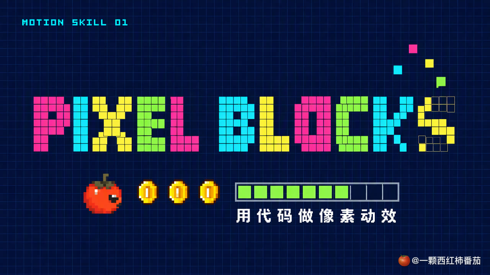
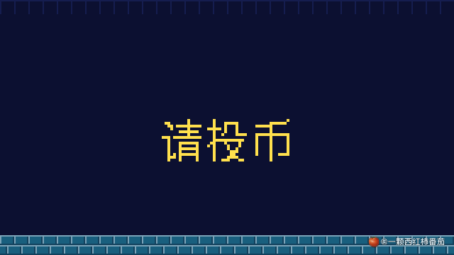
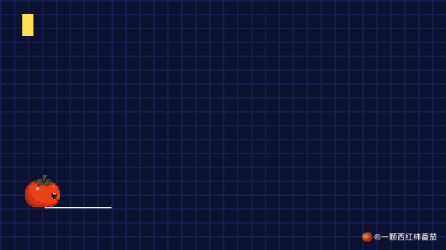
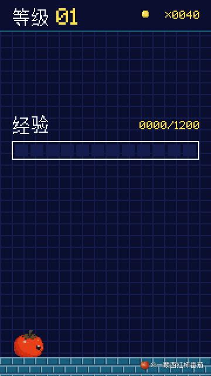
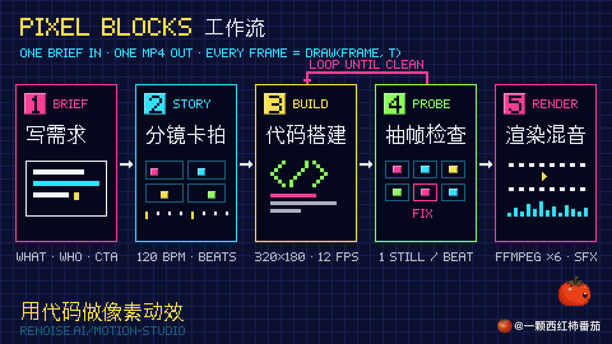
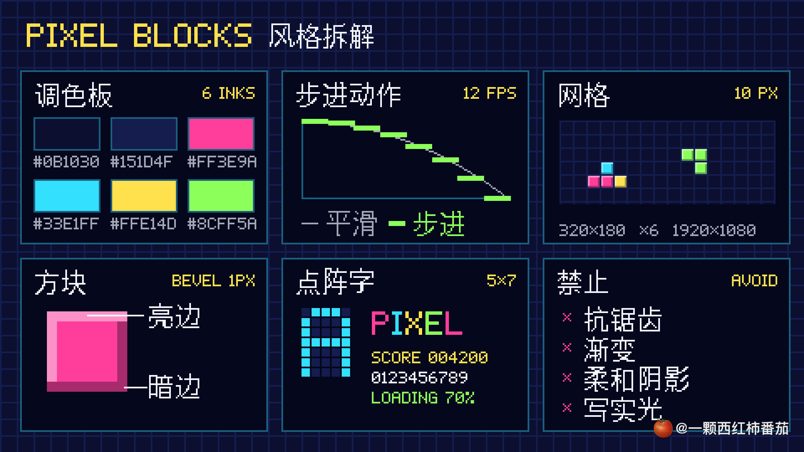
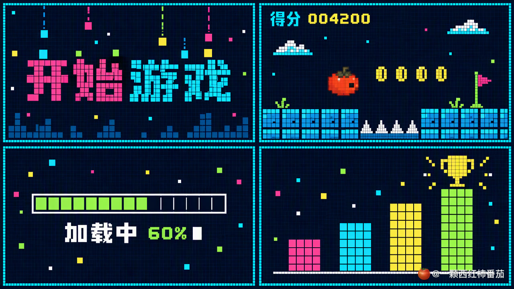
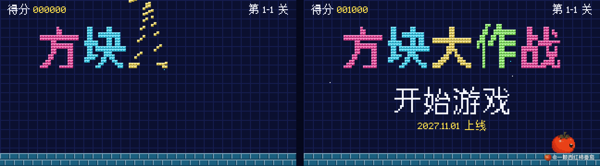
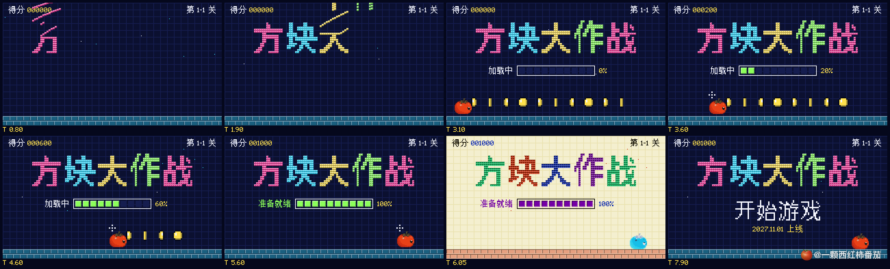
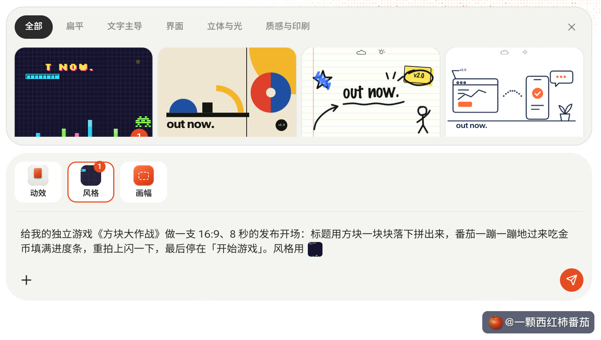

<div align="center">

# Renoise Motion Skills · Pixel Blocks 像素方块

**One sentence → a beat-synced 8-bit motion graphic, drawn frame by frame in code.**
No After Effects, no AI video generation, no browser: a 320×180 framebuffer, a 12-pose-a-second clock and ffmpeg. 8 seconds of 1080p render in about 1 second.

**English** · [简体中文](README.zh-CN.md)

[](LICENSE)

[](https://renoise.ai/motion-studio?utm_source=renoise-motion-skills-tomato-202610&utm_medium=github&utm_content=readme)




</div>

> Not one frame in these clips comes from an AI video model. Every block, letter and coin is computed by code: the title lands one character per beat, each coin fills one cell of the loading bar, and even the coin "ding" is a synthesised square wave.
>
> The only input was one sentence: *"给我的独立游戏《方块大作战》做一支 16:9、8 秒的发布开场：标题用方块一块块落下拼出来，番茄一蹦一蹦地过来吃金币填满进度条，重拍上闪一下，最后停在「开始游戏」。"*
>
> Render time on an Apple M4: **1.17 s** for 8 s of 1080p. Credits spent on the video: **0**.

---

## Demos

Click a GIF (or "Watch") to play the full video with sound. Every demo below was produced with this repo.

| | | |
|:---:|:---:|:---:|
| <a href="https://github.com/chessunyan/renoise-motion-skills/releases/download/v1.0.0/01-launch-intro.mp4"></a> | <a href="https://github.com/chessunyan/renoise-motion-skills/releases/download/v1.0.0/02-data-story.mp4"></a> | <a href="https://github.com/chessunyan/renoise-motion-skills/releases/download/v1.0.0/03-level-up.mp4"></a> |
| **Game launch intro** · 16:9 · 8 s<br>A Chinese title built from falling blocks, coins fill the bar on the eighths, a flash on the drop<br>[▶ Watch](https://github.com/chessunyan/renoise-motion-skills/releases/download/v1.0.0/01-launch-intro.mp4) | **Year-in-review chart** · 16:9 · 8 s<br>Bars stack on sixteenths, each block a semitone higher, trophy, +300% callout, confetti<br>[▶ Watch](https://github.com/chessunyan/renoise-motion-skills/releases/download/v1.0.0/02-data-story.mp4) | **Level-up announcement** · 9:16 · 8 s<br>Quest card, XP bar, 升级！ in blocks, skill card, coins arc into the counter<br>[▶ Watch](https://github.com/chessunyan/renoise-motion-skills/releases/download/v1.0.0/03-level-up.mp4) |

<div align="center">
<b>16-second reel</b> · the two 16:9 clips back to back on one continuous track · <a href="https://github.com/chessunyan/renoise-motion-skills/releases/download/v1.0.0/00-reel.mp4">▶ Watch</a>
</div>

> The hero is the pixel tomato of 一颗西红柿番茄, the author's mascot, and every video carries its watermark. Swap in your own character and logo before you publish: see [Customise](#customise).

---

## What it does

- **Pixel art by code, never by generation.** A scene draws whole-pixel rectangles on a 320×180 (or 180×320) framebuffer; ffmpeg scales it ×6 with nearest-neighbour to 1080p. Nothing is anti-aliased, every block sits on the grid, and any frame re-renders identically.
- **Locked to the beat.** The storyboard is written in beats. Motion runs on a 12-pose-a-second clock (6 poses per beat at 120 BPM), held on twos at 24 fps. Event times and sound cues come from the same functions, so a sound can't drift off its picture.
- **Words built from blocks, Chinese included.** Latin titles use a built-in 5×7 face. CJK text is baked from a system font with anti-aliasing off, in three tiers: 12 px for HUD labels, 16 px for lines and cards, and bold 16 px blown up into 3×3 blocks for titles. Digits fall back to the 5×7 face, so `第 1-1 关` or `0.9万` is one call.
- **Chip sound effects, no samples.** Square, triangle and noise voices with hard envelopes: `tick`, `land`, `coin`, `blip`, `type`, `jump`, `powerup`, `flash`, `select`, `whoosh`, `clear`. Give stacked blocks a rising pitch and the build plays as an arpeggio. Effects sit under the music; the mix is normalised to about −14 LUFS.
- **Probe before render.** One still per beat, tiled into a contact sheet labelled with times, plus a checklist: nothing out of frame, no overlaps, events on their beats, no empty first frame, no final frame caught on a blink.
- **Fast, zero npm dependencies.** Node 18+ and ffmpeg only. About 1 second per 8-second clip, MP4 or GIF, with an optional watermark stamped after the upscale so the logo stays sharp.
- **Works with your agent.** A standard `SKILL.md`: the style contract, a five-step workflow, an engine reference and the pitfalls we hit making the demos.
- **Optional: music from Renoise.** Generate an original chiptune bed with Lyria 3 Pro through the [Renoise MCP](https://renoise.ai/mcp?utm_source=renoise-motion-skills-tomato-202610&utm_medium=github&utm_content=readme) (4 credits in our run). The agent quotes first and waits for your yes.

## How it works

```
your brief ──► 1. brief: what it is · the one message · where it ends · format   (one question at a time if missing)
               2. storyboard on the beat: tempo first, big events on downbeats    → you approve
               3. build the scene: copy the closest example; draw(frame, t) is a pure function of t
               4. probe: one still per beat → contact sheet → fix → again
               5. render ×6 nearest-neighbour + chip SFX + music → MP4 / GIF       (~1 s per 8 s)
```

<p align="center"></p>

---

## Supported agents

The skill is a folder with a `SKILL.md` (the open Agent Skills format) and Node scripts. To run it, an agent needs to:

1. **Load Agent Skills** (a skills folder or a skill upload),
2. **Run commands on your computer** (`node` and `ffmpeg`, to render).

The Renoise MCP is optional and only used to generate music.

| Agent | Skills | Local commands | Status |
|---|---|---|---|
| **Claude Code** | `~/.claude/skills/` | ✅ | ✅ Tested: the demos were made with it |
| **Codex** (CLI / desktop) | `~/.codex/skills/` | ✅ | ✅ Expected to work (same scripts) |
| **OpenClaw** · **WorkBuddy** · other agents with Agent Skills | import the folder or a zip | ✅ | ⚙️ Should work; check the product's docs |
| **Claude desktop / claude.ai** | upload the skill zip in Settings | ⚠️ sandbox | Storyboards and scene code work; rendering needs `node` and `ffmpeg` in the sandbox, otherwise render locally |

---

## Installation

### 1 · Get the code

```bash
git clone https://github.com/chessunyan/renoise-motion-skills.git
cd renoise-motion-skills
```

### 2 · Install the skill into your agent

**Claude Code**
```bash
mkdir -p ~/.claude/skills && cp -R skills/pixel-blocks ~/.claude/skills/
```
**Codex**
```bash
mkdir -p ~/.codex/skills && cp -R skills/pixel-blocks ~/.codex/skills/
```
**WorkBuddy / OpenClaw / other agents**: zip the folder and import it on the product's *Skills* page, or copy it into its skills directory:
```bash
cd skills && zip -r ../pixel-blocks-skill.zip pixel-blocks && cd ..
```

### 3 · Local tools

| Tool | macOS | Windows | Linux |
|---|---|---|---|
| Node.js 18+ | `brew install node` | `winget install OpenJS.NodeJS.LTS` | `nvm install --lts` |
| ffmpeg | `brew install ffmpeg` | `winget install Gyan.FFmpeg` | `sudo apt install ffmpeg` |
| Python 3 + Pillow (only to bake new CJK glyphs) | `python3 -m pip install pillow` | `winget install Python.Python.3.12`, then `pip install pillow` | `sudo apt install python3-pip`, then `pip install pillow` |

Tested on macOS (Apple M4). The scripts use nothing platform-specific, so Linux and Windows should work. Check your setup by rendering a showcase:

```bash
cd ~/.claude/skills/pixel-blocks
node scripts/render.mjs examples/launch-intro.mjs --stills 1.6,7.9 --out /tmp/pixel-check    # contact sheet
node scripts/render.mjs examples/launch-intro.mjs --out /tmp/pixel-check/launch-intro.mp4     # about 1 s
```

`bake-glyphs.py` looks for Hiragino Sans GB on macOS and Noto Sans CJK on Linux. On Windows pass a font: `--font C:\Windows\Fonts\msyh.ttc`.

### 4 · (Optional) Renoise MCP, for generated music

Only needed if you want the agent to compose a chiptune bed. Create an account at **[renoise.ai](https://renoise.ai/mcp?utm_source=renoise-motion-skills-tomato-202610&utm_medium=github&utm_content=readme)**; login happens in the browser, you never paste an API key.

| Agent | How |
|---|---|
| Claude Code | `/plugin marketplace add renoise-ai/renoise-plugins-official`, then `/plugin install renoise@renoise-plugins-official` |
| Codex | `codex mcp add renoise --url https://renoise.ai/api/public/mcp`, then `codex mcp login renoise` |
| Claude desktop / claude.ai | Settings → Connectors → **Add custom connector** → name `Renoise`, URL `https://renoise.ai/api/public/mcp` |
| Other agents | add a remote MCP server with URL `https://renoise.ai/api/public/mcp` |

Without it, use your own track (`music: { file, from }` in the scene) or render without music.

---

## Quick start

Talk to your agent in plain language:

```text
用像素方块风格，给我的 App 做一支 9:16、8 秒的上线倒计时，最后停在「正式上线」。
Make an 8-second 16:9 Pixel Blocks intro for my indie game: the title falls in block by block, end on PRESS START.
做一支 8 秒的年度数据动画：月活按季度从 0.9 万涨到 3.6 万，柱子用方块一块块叠上去，最后撒彩纸。
Use the track I attached and land every block on the beat.
给成片右下角加上我的 logo 水印。
```

What happens next:
1. The agent checks the brief: what it is, the one message, where it ends, the format. Anything missing comes as one short question with a suggested default.
2. A storyboard in beats, with timings and output settings. You approve it.
3. The scene code, then a contact sheet. The agent fixes what's off the beat, overlapping or out of frame.
4. The render: MP4 (plus a GIF on request) with chip sound effects and music.

---

## The style in six rules

<p align="center"></p>

| Token | Value |
|---|---|
| Ground | `#0B1030` navy, with a `#151D4F` grid line every 10 px |
| Inks | pink `#FF3E9A` · cyan `#33E1FF` · lemon `#FFE14D` · lime `#8CFF5A` · white `#F4F6FF`, never a fifth |
| Block | a square with a hard 1-px bevel, light top-left and dark bottom-right |
| Motion | 12 poses a second, held on twos at 24 fps; bars fill whole cells |
| Type | 5×7 bitmap for Latin and digits; baked bitmaps for CJK |
| Never | anti-aliasing, gradients, soft shadows, glow, realistic light |

The contract the agent works to, from Renoise Motion Studio:

> Deep navy ground under a coarse pixel grid. Everything is built from square blocks in an arcade palette of hot pink, cyan, lemon and lime, with chunky pixel type. Shapes and words build up block by block, sprites walk in stepped frames, progress bars fill whole cells at a time and coins blink. Motion is stepped and never smooth, at a low frame rate. Avoid anti-aliased curves, gradients, soft shadows and realistic light.

<p align="center"></p>

A style reference board made with GPT Image 2.5, useful for agreeing on the look with a team. Stills come from image generation; the motion comes from code.

## Chinese pixel type, built from blocks

<p align="center"></p>

Bake the characters a scene uses, then draw them like any other text:

```bash
python3 scripts/bake-glyphs.py "方块大作战" --size 16 --index 2 --out examples/cjk-title.json   # bold, for block titles
python3 scripts/bake-glyphs.py "得分第关加载中" --size 12 --out examples/cjk-12.json           # HUD labels
```

```js
const { cells } = glyphCells('方块大作战', TITLE_FONT, 3);            // every lit pixel becomes a 3×3 block
frame.glyphText('第 1-1 关', W - 8, 4, SMALL, { align: 'right' });   // digits fall back to the 5×7 face
```

## A scene is one function of time

```js
import { C, beats, drawHero, fall, step } from '../scripts/pixel.mjs';

const b = beats(120);                          // b(k) = the time of beat k
export default {
  width: 320, height: 180, duration: b(16),
  draw(frame, t) {                             // no state between frames: any frame renders alone
    const s = step(t);                         // animate on 12 poses a second, never on raw t
    const pose = Math.floor(s * 12);
    frame.grid(10, C.grid);
    for (const block of titleBlocks) {
      const h = fall(s, block.land, block.y + 12, 0.35);   // gravity drop; null before it spawns
      if (h !== null) frame.block(block.x, block.y - h, 3, 3, block.color);
    }
    drawHero(frame, heroX(s), 166, pose % 2 ? 3 : 0);      // no legs, so the tomato hops along
  },
  cues: () => titleLands.map((t) => ({ t, sound: 'land' })),     // the same times as the picture
  music: { file: '../assets/chiptune-120bpm.mp3', from: 18.012 }, // a downbeat in the track
};
```

## Probe before you render

<p align="center"></p>

Every problem in [Known pitfalls](#known-pitfalls-handled-by-the-skill) was caught on a sheet like this, before a full render.

## Chip sound effects

| Cue | Sound | Typical use |
|---|---|---|
| `tick` | short square blip, `pitch` in semitones | a block lands; rising pitch turns a stack into an arpeggio |
| `land` | noise burst + low square | a letter or a heavy block lands |
| `coin` | B5 → E6 | a coin is collected |
| `blip` / `type` | thin square | a bar cell fills / a character types |
| `jump` · `powerup` · `flash` | sweep · arpeggio · noise + triangle | hops, level-ups, the downbeat flash |
| `select` · `whoosh` · `clear` | two notes · noise sweep · jingle | menus, slides, the ending |

## Use it in Renoise Motion Studio (no install)

<p align="center"></p>

Open **[renoise.ai/motion-studio](https://renoise.ai/motion-studio?utm_source=renoise-motion-skills-tomato-202610&utm_medium=github&utm_content=readme)**, click **风格 / Style**, pick **像素方块 / Pixel blocks** and send a one-line brief. The Renoise Agent shows the storyboard and timings first and starts once you say yes.

---

## Cost reference (real runs)

| What | How | Credits |
|---|---|---|
| 3 showcases + the reel | rendered locally by this skill | **0** |
| Chiptune bed, 62 s | Lyria 3 Pro on Renoise | 4 |
| Cover and style board (for the article, not part of the skill) | GPT Image 2.5, 1k | 13 each |

Prices at the time of writing. Always confirm with the agent's live quote.

## Customise

- **Your own hero**: replace `SPRITES.tomato`, `TOMATO_INKS` and `HERO` in `scripts/pixel.mjs`. Our tomato was sampled pixel by pixel from a 32×32 avatar; a hero around 25 px tall reads well at 320 wide.
- **Your own watermark**: `--watermark your-logo.png` on any render, and `python3 brand/apply-watermark.py in.png out.png` for stills.
- **Other formats**: set `width` / `height` to 180×320 for 9:16 or 180×180 for 1:1; output is always ×6.
- **Your own music**: `music: { file, from }` in the scene. Measure the tempo and set `from` to a downbeat.

## Repository structure

```
skills/
  pixel-blocks/                 the skill
    SKILL.md                    style contract · workflow · engine reference · pitfalls
    scripts/
      pixel.mjs                 engine: framebuffer, 5×7 font, sprites, step / beat / fall / hop
      render.mjs                scene → contact sheet / MP4 / GIF (ffmpeg only), --watermark
      chip.mjs                  chip sound effects synthesised from cues
      bake-glyphs.py            CJK text → 1-bit glyph tables
    examples/                   launch-intro · data-story · level-up · reel · baked glyph tables
    assets/                     chiptune-120bpm.mp3
brand/                          the author's watermark + apply-watermark.py for stills
docs/                           README images and GIF previews
```

## Known pitfalls (handled by the skill)

- A 14-px sprite disappears on a 320-px canvas: a hero needs about 25 px, coins scale 2.
- A stack of bars plus a hero plus a trophy runs off the top: lower the block height first, and write values inside the bars on a flat plate (bevel lines run through type otherwise).
- Anything sliding in from the top passes over the HUD: give the HUD its own strip.
- A blinking end card can land on its off frame: keep it lit for the last beat.
- An empty first frame becomes a black thumbnail on social: put something on screen at frame 0.
- At 12 px, dense Chinese glyphs clog up: use 12 px only for short labels.
- A prompt's BPM is a hint: measure the track before cutting to it.
- `python3 -I` hides a user-installed Pillow: run `bake-glyphs.py` without `-I`.

## Responsible use

- The tomato mascot and the "@一颗西红柿番茄" watermark belong to the author. Use them to try the examples, then replace both.
- Use only music, logos and characters you have the rights to.
- The numbers in the year-in-review demo are made up for the demo; label sample data as such if you publish something similar.
- Credits are spent only after you approve the quote.

## License & third-party

- Code and docs: [MIT](LICENSE) © 2026 chessunyan (一颗西红柿番茄).
- Not covered by MIT: the tomato mascot and the watermark, the demo videos, the chiptune track and the generated images. The CJK glyph tables are rasterised from a macOS system font. Details in [THIRD_PARTY.md](THIRD_PARTY.md).
- ffmpeg is called as an external program and is not bundled.

---

<div align="center">

Made by **一颗西红柿番茄** · style from [Renoise Motion Studio](https://renoise.ai/motion-studio?utm_source=renoise-motion-skills-tomato-202610&utm_medium=github&utm_content=readme) · built with Claude Code · if this helped, a ⭐ helps others find it.

</div>
